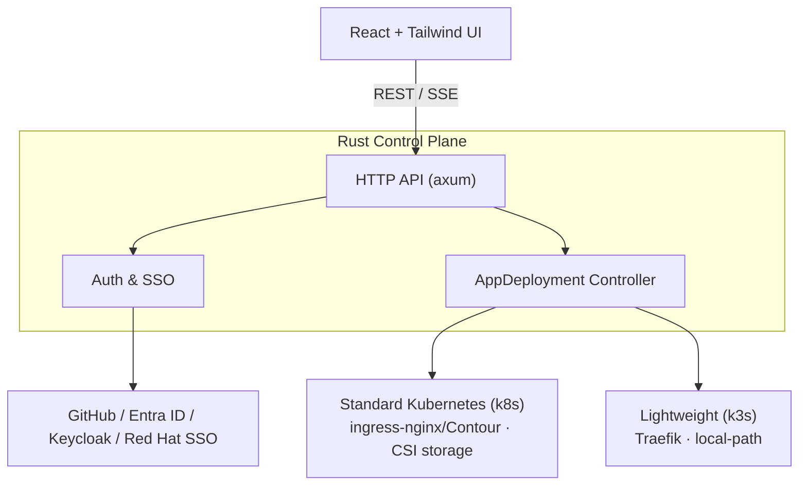

# KubeWeave

**KubeWeave** is a self-service developer platform for turning a Git repository into a
running, routable application across standard Kubernetes (k8s) and lightweight k3s
clusters — without hand-writing manifests, build jobs, ingress, or storage configuration.

Think of it as an early, lightweight take on the OpenShift-style developer experience:
one control plane, one UI, and one API in front of multiple heterogeneous clusters
(cloud k8s and edge k3s side by side), each with sane defaults for ingress, storage, and
image builds baked in per cluster type. You register clusters once; developers then just
point at a Git repo and a target cluster.

- **Control plane**: Rust (axum + kube-rs), single statically linked binary.
- **UI**: React + TypeScript + Tailwind, generated REST client from the OpenAPI contract.
- **Desired state**: a Kubernetes custom resource (`AppDeployment`), reconciled by an
  in-process controller — inspectable with `kubectl`, restart-safe.
- **Auth**: OIDC/OAuth2 SSO (GitHub, Microsoft Entra ID, Keycloak, Red Hat SSO) with
  group-to-role mapping.

> **Status**: v1.0.0 initial release, under active/in-progress development. Core
> single-cluster flows (auth, app create/build/deploy, log streaming) work end to end;
> multi-cluster fleet management, richer topology views, and production hardening are
> still being built out. See [CHANGELOG.md](CHANGELOG.md) for release notes.

## Why KubeWeave?

Running apps on Kubernetes usually means writing and maintaining Deployments, Services,
Ingresses, PVCs, and a build pipeline by hand — and doing it all over again, slightly
differently, for every cluster flavor you support. KubeWeave removes that duplication:

- **One Git push in, a running app out.** Point KubeWeave at a Git repo and a target
  cluster; it builds the image (rootless BuildKit), pushes it to your registry, and
  renders the Deployment/Service/Ingress for you.
- **k3s and standard k8s from the same control plane.** Register edge k3s nodes and
  full k8s clusters side by side. Each gets correct defaults automatically (Traefik +
  `local-path` on k3s, ingress-nginx/Contour + CSI storage on k8s) — developers never
  pick the "right" ingress class or storage class themselves.
- **No new source of truth to babysit.** Desired state lives in a single Kubernetes
  custom resource (`AppDeployment`) per app, so it's restart-safe, diffable, and
  inspectable with plain `kubectl` — no separate database to back up or get out of sync.
- **SSO and RBAC out of the box.** GitHub, Microsoft Entra ID, Keycloak, or Red Hat SSO
  log users in; their IdP groups map straight to `viewer` / `developer` /
  `platform-admin` roles, enforced on every API call.
- **Live visibility while it builds and runs.** Build and runtime logs stream to the UI
  over SSE as they happen, so you're not guessing why a deploy is stuck.

In short: the parts of an OpenShift-style internal developer platform that are genuinely
tedious to hand-roll — multi-cluster defaults, build-to-deploy automation, SSO/RBAC, and
a live view of what's happening — in a single small Rust binary plus a React UI.

## Architecture



## Repository layout

```
api/              OpenAPI 3.0 contract (source of truth for the REST/SSE API)
control-plane/    Rust Cargo workspace (control plane + controller)
deploy/crds/      AppDeployment CustomResourceDefinition
ui/               React + Tailwind frontend
```

## Prerequisites

- Rust (stable toolchain, edition 2021) and Cargo
- Node.js 18+ and npm
- A Kubernetes cluster you can reach with `kubectl` (k3s or standard k8s)
- `openssl` (to generate the session-signing keypair)

## Getting started

### 1. Install the CRD

```bash
kubectl apply -f deploy/crds/appdeployments.kubeweave.io.yaml
kubectl get crd appdeployments.kubeweave.io
```

### 2. Configure the control plane

```bash
cd control-plane
cp config.example.yaml config.yaml

mkdir -p dev-keys
openssl genpkey -algorithm ed25519 -out dev-keys/private.pem
openssl pkey -in dev-keys/private.pem -pubout -out dev-keys/public.pem
```

Edit `config.yaml`:
- Set `home_namespace` to a namespace that exists in your cluster (used for the session
  denylist `Lease` objects).
- Under `clusters:`, point `kubeconfig_path` at a kubeconfig for each target cluster, or
  omit it to use the in-cluster config when the control plane itself runs inside the
  cluster. Set each cluster's `registry` to a container registry you can push to
  (Docker Hub, GHCR, GitLab Container Registry).
- Under `oauth_providers:`, fill in the client ID/secret for the identity providers you use;
  remove the ones you don't need.

`config.yaml` and `dev-keys/` are gitignored — never commit real credentials.

### 3. Run the control plane

```bash
cd control-plane
KUBEWEAVE_CONFIG=./config.yaml cargo run -p kubeweave-bin
```

The API listens on `bind_addr` from `config.yaml` (default `0.0.0.0:8080`), and exposes
`/healthz` and `/readyz`.

### 4. Run the UI

```bash
cd ui
npm install
npm run generate-client   # regenerates src/api/schema.ts from api/openapi.yaml
npm run dev
```

The dev server proxies `/api` and `/healthz` to `http://localhost:8080` (see
`ui/vite.config.ts`), so cookies and SSE work without CORS.

## Building for production

```bash
# Control plane
cd control-plane && cargo build --release -p kubeweave-bin

# UI (static assets under ui/dist/)
cd ui && npm run build
```

### Docker Compose

`docker-compose.yml` packages both as container images (control plane: multi-stage Rust
build; UI: nginx reverse-proxying `/api` to the control plane on one origin):

```bash
make keys && make config   # generate signing keys + config.yaml, then edit config.yaml
make docker-up             # docker compose up -d --build
make docker-down
```

See [docs/DEPLOYMENT.md](docs/DEPLOYMENT.md#docker-compose-production-style) for the
config paths and kubeconfig setup this expects.

## Testing

```bash
cd control-plane && cargo test --workspace
cd ui && npm run test && npx tsc -b && npm run build
```

A `Makefile` wraps these (and more) for local use — run `make help` for the full list,
or `make verify` to run everything (fmt, clippy, tests, UI typecheck/test/build) before a release.

## Documentation

- [Deployment guide](docs/DEPLOYMENT.md) — installing the CRD and running against a cluster you control
- [Testing](docs/TESTING.md) — what's covered per crate and how to run everything
- [Release process](docs/RELEASE.md) — checklist for cutting a new version
- [OpenAPI contract](api/openapi.yaml)
- [Changelog](CHANGELOG.md)

## License

Licensed under the [Apache License 2.0](LICENSE).
